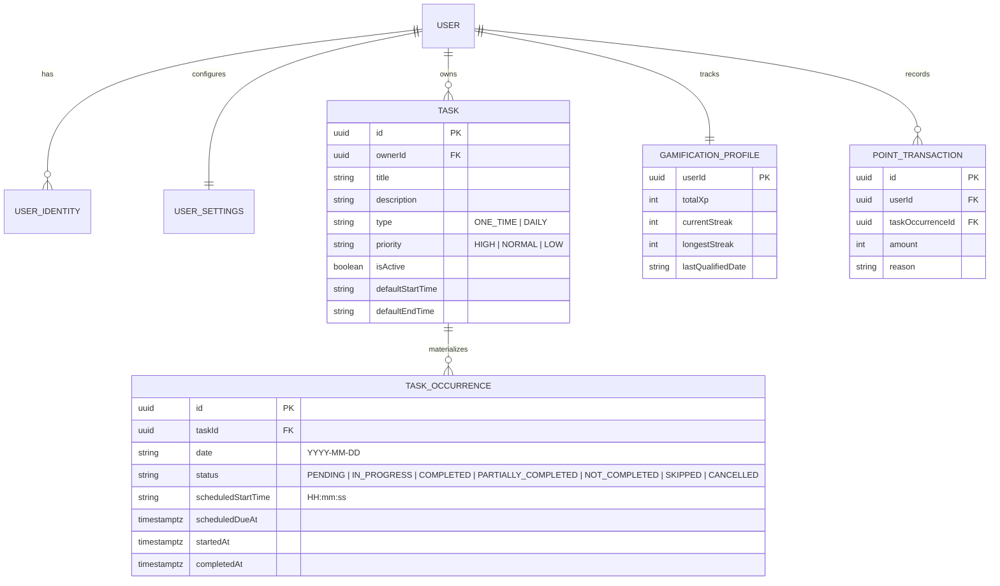

# Product and UX Brief — Task Manager Platform

> Authoritative product overview, core entities, verified user journeys, and UX foundations established for the Task Manager Platform. Designed to guide consistent user experience across the Telegram Bot and future Web/API clients.

---

## 1. Product Purpose & Value Proposition

The **Task Manager Platform** is a multi-channel productivity and habits system designed to help users capture, schedule, track, and sustain daily momentum without cognitive overload.

Unlike traditional static todo lists that quickly turn into overwhelming backlogs, this platform couples:
1. **Lightweight Task Registration**: Rapid multi-line natural text input supporting untimed tasks, single start times, and duration intervals in both Persian and English.
2. **Discrete Occurrence Execution Model**: Separation between a task definition (e.g., daily recurring habits vs. one-off tasks) and its date-specific operational instances (`TaskOccurrence`), enabling daily agenda generation and historical auditing.
3. **Non-Punitive Gamification Ledger**: An authoritative XP points ledger (`point_transactions`), level progression (Levels 1–30+ across semantic tiers), streak tracking with bonus multipliers (up to 2.0x), and a rolling Consistency Score (0–100) that measures execution fidelity rather than raw volume.
4. **Timezone-Aware Scheduling & Background Notifications**: Accurate local day boundaries across global IANA timezones, proactive minutely scheduled start alerts, and automatic expiration of unacknowledged scheduled occurrences.

---

## 2. Core Entities & Domain Model

Understanding these entities is mandatory for designing any client interface (Web, Mobile, or Bot):

### Key Distinctions
- **`Task` vs. `TaskOccurrence`**:
  - `Task` defines *what* needs to be done, its recurrence rule (`ONE_TIME` vs `DAILY`), default priority, and default times.
  - `TaskOccurrence` represents the actionable item for a specific calendar date (`YYYY-MM-DD`). Changing the status of today's occurrence never mutates past or future occurrences.
- **Occurrence Statuses & Lifecycle Rules**:
  - `PENDING` (🟡 در انتظار): Initial state upon materialization.
  - `IN_PROGRESS` (🔵 در حال انجام): User has started the task.
  - `COMPLETED` (🟢 تکمیل‌شده): Terminal state. Triggers atomic XP award and streak evaluation. Cannot be reopened.
  - `PARTIALLY_COMPLETED` (🟠 تکمیل جزئی): User made partial progress. Triggers fractional XP award. Terminal.
  - `NOT_COMPLETED` (🔴 انجام‌نشده): Occurrence passed without completion (or timed out after 30m inactivity). Terminal.
  - `SKIPPED` (⚪ ردشده): Intentionally skipped by the user for today. Neutral for streaks.
  - `CANCELLED` (⚫ لغوشده): Cancelled instance. Terminal.
- **Deactivation vs. Deletion Policy**:
  - A task with completed occurrences or awarded points **cannot be permanently deleted** in order to preserve audit and ledger integrity.
  - For daily recurring tasks, users **deactivate** (`isActive = false`), stopping future occurrence materialization while preserving full history and statistics.

---

## 3. Verified Core User Journeys

### Journey 1: Frictionless Onboarding
1. User starts the bot (`/start`).
2. System presents suggested name from Telegram profile with one-tap confirmation or custom name input.
3. System defaults to local timezone (`Asia/Tehran`) with one-tap confirmation or full IANA city picker.
4. System introduces the gamification system (XP, Level, Streak, Consistency Score) in respectful, motivating language.
5. User arrives at the Main Menu with an initialized account.

### Journey 2: Fast Task Creation
1. User taps «➕ ثبت تسک جدید» and chooses task type:
   - **تسک یک‌باره (One-Time)**: Interactive calendar picker selects target date (preventing past date selection).
   - **تسک روزانه تکرارشونده (Daily Recurring)**: Activates immediately for daily occurrence generation.
2. User enters registration mode where they can send multiple lines or multiple text messages:
   - Line 1: `خرید میوه و نان` (Untimed)
   - Line 2: `ورزش ساعت 18:00` (Start time)
   - Line 3: `مطالعه از 09:00 تا 10:30` (Time window)
3. Deterministic parsing validates format; errors on invalid lines are clearly highlighted by line number while valid entries are preserved.
4. User taps «🏁 پایان ثبت تسک‌ها» to return to the Main Menu.

### Journey 3: Daily Agenda & Execution
1. User taps «📋 تسک‌های امروز».
2. System idempotently ensures today's daily occurrences are materialized in the user's timezone.
3. System presents an interactive list sorted with timed tasks first, showing current completion progress (e.g. `پیشرفت: ۲ از ۵ تکمیل‌شده`).
4. Each task button prominently displays its current status icon, title, and scheduled time.
5. Tapping a task opens its interactive card:
   - Mark as `IN_PROGRESS` or `COMPLETED`.
   - Edit title, description, priority, or schedule.
   - Receive immediate, encouraging toast feedback with XP confirmation.

### Journey 4: Gamification Motivation & Progress Review
1. User taps «🏆 وضعیت پیشرفت و امتیازات» or runs `/profile` / `/stats`.
2. System renders a dark-mode consistency trend chart (or text card fallback):
   - Current Level and Tier Title (e.g., `سطح ۲ — شروع‌کننده`).
   - Progress bar to next level (`80/141 XP [▓▓▓▓░░░░░░ 56%]`).
   - Current and longest streak with active multiplier badge (`1.08x`).
   - Consistency Score with filter buttons: `۷ روز اخیر`, `۳۰ روز اخیر`, `کل تاریخچه`.
   - Real breakdown counts of completed, partially completed, and not completed tasks for the active period.

### Journey 5: Account & Profile Settings
1. User taps «⚙️ تنظیمات».
2. System shows current profile overview: Display Name, IANA Timezone, and Automated Reminders status.
3. User can one-tap to edit display name or change timezone via an interactive picker.
4. Changes take effect immediately across all daily schedules and reminders.

---

## 4. Usability Principles Established

1. **Scannability First**:
   - In chat and dashboard environments, users should identify tasks and actions in under 2 seconds. Task list buttons must reflect the actual task title and status, not abstract labels like "نمایش تسک ۱".
2. **Context-Sensitive, Non-Robotic Feedback**:
   - Status transitions must state exactly what happened (e.g., `🎉 تسک با موفقیت تکمیل شد و امتیاز (XP) به حساب شما افزوده شد!` rather than generic `عملیات موفق بود`).
3. **Honesty & Transparency in Data**:
   - Never fabricate zero counts or provisional data. If a metric is provisional (< 5 tasks), state clearly that it is forming.
   - For untimed tasks, indicate `شناور (انجام در طول روز)` rather than repeating `مشخص نشده` across multiple lines.
4. **Forgiving by Design**:
   - Allow safe back-navigation from every screen.
   - Protect history: prevent destructive deletion of audited tasks, guiding users toward safe deactivation.

---

## 5. Confirmed Product Behavior vs. Web Design Recommendations

| Concept | Confirmed Backend Behavior | Web UI Recommendation |
|---|---|---|
| **Occurrence Materialization** | On-demand per date (`ensureDailyOccurrencesForDate`) + hourly cron catch-up. | When rendering calendar or week view on web, batch-fetch/materialize the requested date range. |
| **Occurrence Finality** | `COMPLETED` and `CANCELLED` occurrences cannot change status in core domain. | Render completed tasks with completed visual styling (strikethrough / checkmark) and lock status actions. |
| **Streak Requirement** | At least 1 completed task per calendar date in user's timezone. | Show a visual flame badge on today's calendar cell once the day is qualified. |
| **Consistency Score** | Computed over eligible occurrences (`sampleCount >= 5` to settle). | Display an explanatory tooltip or info banner when score is in provisional mode. |
