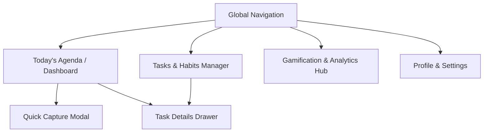

# Web UI/UX Design Brief — Task Manager Platform

> Comprehensive architectural and UX brief for designing a modern, high-fidelity Web interface for the Task Manager Platform. This document grounds all screen layouts, states, and user interactions in verified backend capabilities and domain contracts.

---

## 1. System Architecture & Context for Web Designers

The Task Manager Platform is built on a modular NestJS backend with decoupled domain libraries (`@app/core`, `@app/database`). While initial interaction was deployed via a Grammy Telegram bot (`apps/bot`), all core use cases (`TasksService`, `GamificationService`, `UsersService`) are delivery-agnostic.

### Backend Capabilities Available for Web
- **Daily Occurrence Materialization**: `ensureDailyOccurrencesForDate(userId, dateIso)` idempotently generates today's occurrences for active tasks and returns occurrences sorted with timed tasks first.
- **Natural Multi-Line Task Parsing**: `TaskTextParser` accepts multi-line text input with Persian or English numerals, extracting title, scheduled start, and scheduled end times.
- **Task Lifecycle Control**:
  - Start, complete, partially complete, mark not completed, skip, and cancel occurrences.
  - Safe task deactivation (`deactivateTask`) for recurring tasks.
  - Protected deletion (`deleteTask`) with audit safeguards against deleting tasks with point transactions.
  - Scope-based schedule updates for recurring tasks («فقط برای امروز» vs «برای همه روزها»).
- **Gamification Engine**:
  - XP ledger (`point_transactions`) and atomic awards on completion.
  - Mathematical level progression with semantic tier titles (`شروع‌کننده`, `سازنده عادت`, `پایدار`, `استاد استمرار`).
  - Daily streak engine with bonus multiplier (1.0x to 2.0x).
  - Rolling Consistency Score (0–100) with period trend buckets (`7d`, `30d`, `all`).

---

## 2. Major Screens & Information Hierarchy

### Screen 1: Today's Agenda (`/today` or `/`)
- **Primary Goal**: Immediate clarity on today's commitments, effortless progress tracking, and rapid task completion.
- **Key Elements**:
  - **Header Bar**:
    - Current local date (Persian / Gregorian).
    - Daily Progress Bar: e.g. `۳ از ۵ تسک تکمیل‌شده (۶۰٪)`.
    - Active Streak Flame Widget: `🔥 ۴ روز (ضریب ۱.۰۸x)`.
    - Quick Action Button: `➕ ثبت تسک سریع`.
  - **Timed Agenda Section (Timeline View)**:
    - Chronologically ordered tasks with scheduled time windows (e.g., `۰۸:۰۰ تا ۰۹:۰۰`).
    - Interactive checkmark to complete with celebratory micro-animation (+XP badge popup).
    - Status pill with color codes (🟢 Completed, 🔵 In Progress, 🟡 Pending, 🟠 Partial).
  - **Untimed Pool (Anytime Today)**:
    - Tasks without specific hours (`شناور`).
    - Drag-and-drop or one-click time assignment.
- **States**:
  - **Empty State**: Welcoming illustration, `شما هیچ تسکی برای امروز ندارید`, with primary button `➕ ثبت تسک جدید`.
  - **Loading State**: Skeleton cards reflecting timeline slots.

### Screen 2: Quick Capture & Batch Task Creation Modal
- **Primary Goal**: Zero-friction task entry without navigating away from the current view.
- **Key Elements**:
  - **Type Selector Tabs**:
    - `📌 تسک یک‌باره (One-Time)`: Displays inline date picker defaulting to today.
    - `🔄 تسک روزانه تکرارشونده (Daily Recurring)`: Activates recurring habit mode.
  - **Multi-Line Smart Input Textarea**:
    - Allows typing multiple tasks separated by line breaks.
    - Real-time syntax helper previewing recognized times (e.g. `خرید نان ساعت 18:00` -> preview tag `⏰ 18:00`).
  - **Syntax Hint Bar**:
    - Examples of untimed, start-only, and interval formats in Persian and English.
  - **Validation & Error Feedback**:
    - Non-destructive error reporting indicating specific line numbers (e.g. `سطر ۲: ساعت پایان نمی‌تواند قبل از ساعت شروع باشد`).

### Screen 3: Task Details & Management Drawer (`/tasks/:id`)
- **Primary Goal**: Deep inspection, status changes, schedule tuning, and lifecycle operations.
- **Key Elements**:
  - **Header**:
    - Task title (inline-editable).
    - Status badge and priority indicator (🔴 High, 🟢 Normal, ⚪ Low).
  - **Schedule Card**:
    - Start time, end time, and estimated duration.
    - Recurring schedule scope selector when updating time on a daily task:
      - `فقط برای امروز (Only for today)`
      - `برای همه روزها (Default for all future days)`
  - **Description**: Rich text or markdown notes.
  - **Audit Metadata**:
    - Created at, Started at, Completed at in user's timezone.
  - **Lifecycle Actions**:
    - Status actions: Complete, Start, Partial Complete, Skip, Cancel.
    - If status is `COMPLETED` or `CANCELLED`: status buttons are disabled with note `این تسک در وضعیت نهایی قرار دارد`.
    - Recurring deactivation button: `🛑 غیرفعال کردن تکرار روزانه (حفظ تاریخچه و امتیازها)`.
    - Permanent delete button: protected by backend check; if points exist, shows advisory modal directing to deactivation.

### Screen 4: Gamification & Analytics Hub (`/stats`)
- **Primary Goal**: Motivate long-term consistency, celebrate milestones, and inspect productivity trends.
- **Key Elements**:
  - **Hero Level Badge**:
    - Current Level number & Tier Title (`سطح ۲ — شروع‌کننده`).
    - XP progress bar to next level (`80 / 141 XP`).
    - Total lifetime XP ledger counter.
  - **Streak & Consistency Highlights**:
    - Current streak (days) and all-time record.
    - Active XP multiplier card (e.g., `⚡️ ضریب پاداش: 1.08x`).
  - **Interactive Consistency Trend Chart**:
    - Period filter tabs: `۷ روز اخیر`, `۳۰ روز اخیر`, `کل تاریخچه`.
    - Line chart displaying rolling Consistency Score (0–100%) with clean dark-mode gradients and gap preservation.
    - Provisional indicator banner if sample size < 5 occurrences:
      `💡 شاخص پایداری در حال شکل‌گیری است (برای تثبیت، حداقل ۵ تسک نیاز است).`
  - **Activity Breakdown Cards**:
    - Total completed, partially completed, and not completed counts for the selected period.
    - Daily streak qualification tracker: displays distinct tasks completed today vs requirement (e.g. `۲ از ۳ تسک تا تثبیت زنجیره امروز`).
  - **Level Progression & XP Ledger Drawer**:
    - Progressive tier classification (Levels 1–5: شروع‌کننده, 6–15: سازنده عادت, 16–30: پایدار, 31+: استاد استمرار).
    - Base reward guide: On-time (+10 XP), Late/Floating (+7 XP), Partial (+4 XP), Streak multiplier boost.
    - Recent audit log of PointTransaction entries (timestamp, points delta, reason, task title).

### Screen 5: Profile & Account Settings (`/settings`)
- **Primary Goal**: Manage account identity, local timezones, and notifications.
- **Key Elements**:
  - **Display Name**: Editable text field with 100-character validation.
  - **Timezone Selector**: Searchable IANA timezone dropdown (with prominent defaults for Tehran, UTC, European and American capitals).
  - **Connected Channels**: Status of Telegram Bot connection and scheduled start notifications.

---

## 3. UI States Matrix

| State Type | Trigger / Condition | Visual Presentation | Primary Action |
|---|---|---|---|
| **Loading** | Initial page load or date query | Skeleton cards mimicking timeline and metrics | None (disabled) |
| **Empty Daily List** | No tasks materialized for date | Polite illustration, clear copy: `هنوز تسکی برای امروز ثبت نکرده‌اید` | `➕ ثبت اولین تسک امروز` |
| **Empty Chart** | New user with 0 evaluated tasks | Chart axis shown with subtle dashed baseline | `💡 با تکمیل اولین تسک، نمودار پیشرفت شما فعال می‌شود` |
| **Provisional Score** | Sample count < 5 occurrences | Score displayed with `در حال شکل‌گیری` badge | Informative tooltip explaining score formula |
| **Terminal Status** | Task `COMPLETED` or `CANCELLED` | Checkmark badge, actions locked | Read-only with XP award highlight |
| **Delete Blocked** | Task has point transactions | Modal explaining audit protection | Switch to `غیرفعال‌سازی تسک` |
| **Network / Error** | API failure | Friendly banner: `خطا در دریافت اطلاعات. اتصال خود را بررسی کنید` | `🔄 تلاش مجدد` |

---

## 4. Responsive & Ergonomic Considerations

- **Desktop (>= 1024px)**:
  - 3-column or split layout: Left sidebar navigation, central daily timeline agenda, right persistent widget showing level progress, streak flame, and today's consistency score.
  - Hotkeys: `N` for new task modal, `Space` to toggle completion on selected task, `J`/`K` for timeline navigation.
- **Tablet / Mobile (< 1024px)**:
  - Single column with bottom navigation bar (Today, Tasks, Stats, Settings).
  - Floating Action Button (FAB) `➕` pinned to bottom-right for thumb-zone quick capture.
  - Swipe gestures on task cards: Swipe right to Complete, swipe left for Actions/Edit drawer.
- **RTL (Right-to-Left) First**:
  - Primary text alignment is RTL for Persian (`dir="rtl"`).
  - Digits and timestamps (`HH:mm`, `YYYY-MM-DD`) should use standard legible layout without reversed punctuation.
  - Progress bars fill from right to left in RTL layouts.

---

## 5. Verified Backend Capabilities vs. Open Gaps for Future Web Agents

### Verified & Ready
- All domain rules for task occurrence status changes and idempotent daily materialization are verified and covered by 420+ automated unit tests.
- Gamification calculations (XP, level tiers, streak multipliers, consistency scores) are fully deterministic and available via `@app/core`.
- Parser logic (`TaskTextParser`) supports both Persian and English syntax with numeral normalization.

### Gaps / Open Questions for Future Web Agent
1. **HTTP API Layer Scaffolding**:
   - `apps/api` currently contains only a minimal Nest placeholder (`ApiController` returning "Hello World!").
   - A dedicated REST or GraphQL controller layer exposing `@app/core` methods (`TasksService`, `GamificationService`, `UsersService`) must be wired before the web frontend can communicate with PostgreSQL.
2. **Web Authentication Contract**:
   - Currently, authentication is tied to `UserIdentity` with provider `TELEGRAM`.
   - For web access, the system must define a web authentication mechanism (e.g., Telegram Login Widget, JWT session tokens, or OTP/magic link).
3. **Real-time WebSockets / Push Notifications**:
   - The backend scheduler (`TaskSchedulerService`) currently dispatches scheduled start reminders directly via the Grammy Telegram bot API.
   - For web notifications, a Web Push or Server-Sent Events (SSE) gateway needs to be connected to the scheduler.
